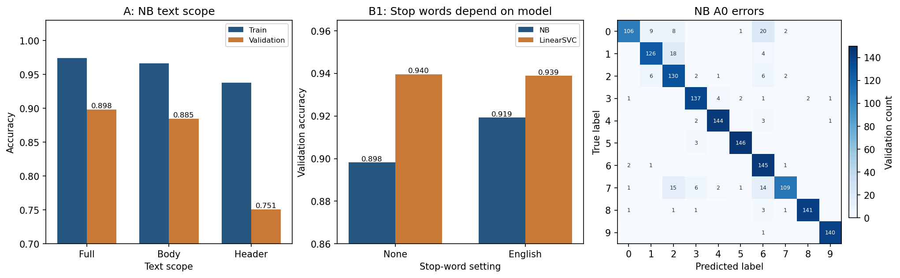
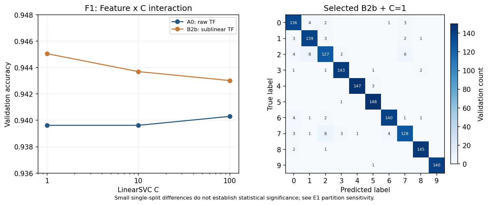

# Lab1 文本分类实验 · 朴素贝叶斯

01 / 基线、文本范围与特征对照

## 问题与实验设置

检验头部信息及词频表示是否改善分类。数据为课程提供的 CSV：7368 条有标签文本、10 类（每类705-747条），2457 条无标签测试文本。先以 SEED=42 分层划分5894/1474（80/20），再仅在训练部分拟合词表与 IDF。accuracy 为预先锁定主指标，macro-F1 为辅指标；类别只用数字标签。

## 原理与控制变量

MultinomialNB 采用类别条件下特征独立假设，alpha=1 作平滑；TF-IDF 是非负加权特征，但不完全等同词频计数假设。A0 为向量器全默认：小写、词级一元组、L2归一化、无限词表。A/B各次仅改表中一个因素；诊断对象不保存。

## 参数对照（实测）

方案（其余参数固定）; 特征数; 训练 Acc; 验证 Acc; 验证 F1

- 全文 A0; 99901; 0.9739; 0.8982; 0.8984
- 仅正文 A1; 96513; 0.9662; 0.8847; 0.8848
- 仅头部 A2; 16975; 0.9379; 0.7510; 0.7481
- 英文停用词 B1b; 99595; 0.9818; 0.9193; 0.9195
- 对数词频 B2b; 99901; 0.9776; 0.9016; 0.9020
- 词/二元词组 B3b; 723275; 0.9912; 0.9009; 0.9009

## 结果与误差（实测 / 推断）

NB A0 的训练/验证差为0.0756，验证错150条；0→6有20条、1→2有18条。英文停用词将NB验证Acc提高0.0210，而SVM变化为-0.0007，说明结论依赖模型。仅头部仍达0.7510，但训练/验证差增至0.1869。由此推断头部含可利用关联信息，不能证明跨来源泛化。

## 原文定性检视

错例索引431（0→6）：标题提到地球图像，正文主要讨论版权、转载与商业使用。这是可回查个案的解释假设，未验证错误的因果机制；8个代表性错例见qualitative_error_review.json。

## 思考3：其他表示与局限

词袋可直接保留计数；Word2Vec可得到静态语义向量，BERT可表示上下文语义（任务书给出的扩展方向）。本实验未实现后二者，不能声称它们更优。二元组使词表增至723275，而NB仅提升0.0027，提示应同时考虑精度与复杂度。

# Lab1 文本分类实验 · 线性支持向量机

02 / 参数交互、稳健性与最终提交

## 原理与选参

LinearSVC 用线性决策函数、L2正则、squared_hinge损失及OvR多分类；C越大正则越弱。它与SVC(linear)默认损失/多分类策略不同。D1固定A0扫描C={0.1,1,10,100}；F1显式登记为两因素2×3交互网格。沿用验证Acc优先、同分比macro-F1、再选更简单候选的规则。

## 最终方案（实测）

现有51行记录去重比较，选全文TF-IDF sublinear_tf=True、C=1；验证Acc=0.945047，macro-F1=0.944995，训练/验证差=0.0548。全部7368条重新拟合Pipeline（107882维），再按测试原顺序预测；2457×1、0-9整数、无表头/索引三项断言及顺序检查通过。测试真实标签未知。

## 参数对照（实测）

TF-IDF / C; 训练 Acc; 验证 Acc; 验证 F1; 迭代数

- A0 / 1; 0.9998; 0.9396; 0.9397; 40
- A0 / 10; 1.0000; 0.9396; 0.9398; 293
- A0 / 100; 1.0000; 0.9403; 0.9404; 1504
- B2b / 1; 0.9998; 0.9450; 0.9450; 40
- B2b / 10; 1.0000; 0.9437; 0.9436; 280
- B2b / 100; 1.0000; 0.9430; 0.9429; 1571

## 交互、误差与稳健性

A0在C=100略高，B2b在C=1最高；直接拼装B2b+C=100为0.943012，低于0.945047。E1中B2b相对A0在4/5种子提高、1/5打平；跨种子标准差0.0057-0.0089只是描述量，未做显著性检验，也未跨种子验证完整F1。验证诊断模型错81条；索引67（2→1）：正文讨论DOS安装、磁盘压缩及内存，软件和硬件词汇交叉。E2两比例的模型排序一致，但划分嵌套，证据非独立。

## 思考1：为何线性模型有效

A0有99901维、约99.84%稀疏；线性模型可在稀疏特征上学习类别区分权重，正则约束容量。相同A0下SVM/LR/NB验证Acc为0.9396/0.9186/0.8982；这是本实验支持线性模型的证据，不能外推到所有文本数据。

## 思考2：MLP结构、正则及风险

固定20次迭代预算，(100,)/(200,)/(100,50)验证Acc为0.9349/0.9342/0.9322，训练Acc均为1.0；alpha=1e-3仅提高到0.9362，未明显缩小差距。全部未收敛，扩大结构在此预算下无收益；更多迭代、早停或降维可能改变结果，尚未验证。首层约1000万参数，高于线性模型的约100万权重。

## 结论与证据边界

对数词频与参数交互是有实测对照的探索；验证集多次参与选择，最高分存在选择偏差。报告仅用NB/SVM各一页，其他模型作为扩展证据。课程原PDF物理第16页要求≤5页；按WORKFLOW记载的教师后续≤2页更新执行，该更新为用户转述、未独立核验。

Python 3.10.22 / sklearn 1.7.2 / NumPy 2.2.6 / OpenBLAS；Ryzen 5 5600H、可用物理内存15.4 GiB。AI辅助实现与撰写；提交者需复核。

数值证据：results/logs/experiments_abc.json、experiments_d.json、experiments_f1.json、seed_robustness.json、val_size_robustness.json、error_analysis.json、final_summary.json。

原理来源：实验一要求.pdf 与当前安装 scikit-learn 1.7.2 的模型/向量器文档字符串。
