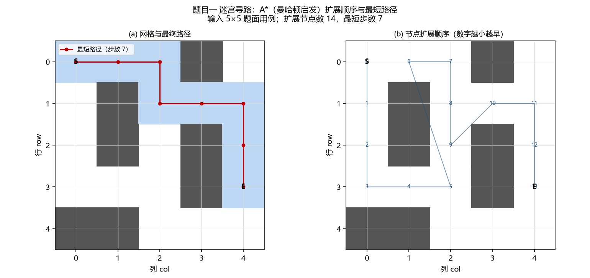
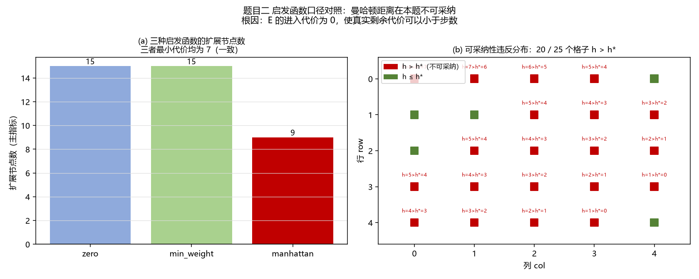
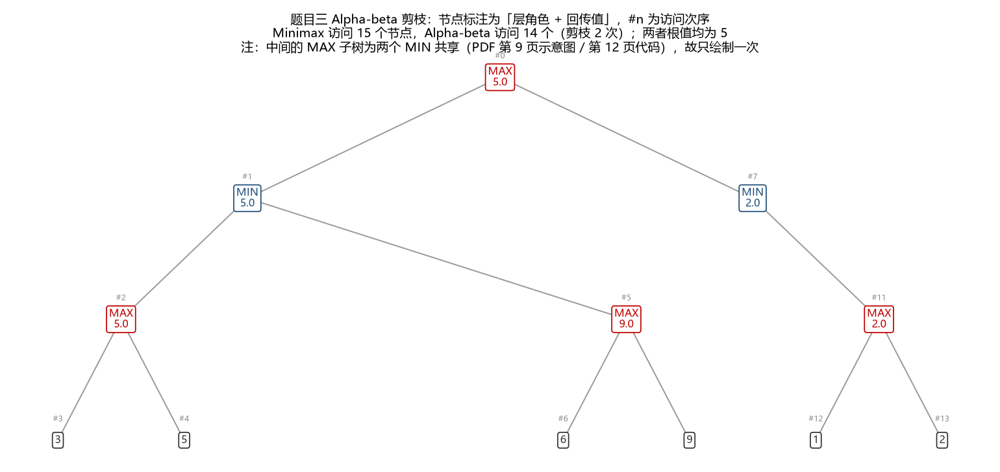
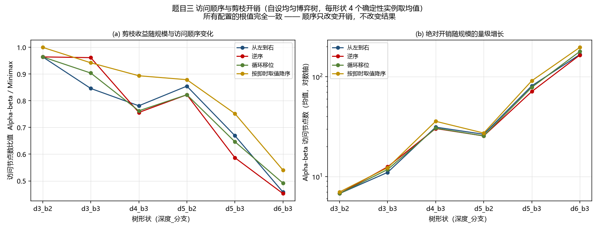
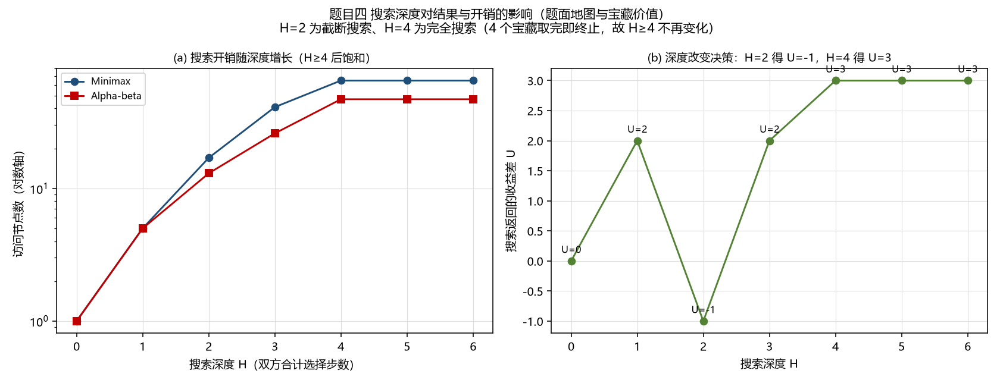

# 当代人工智能 Lab2——搜索算法

仓库链接：https://github.com/oceancat91/AI-Lab.git（Lab02）

目标：实现 A* 与 Alpha-Beta 剪枝，并用对照实验说明启发函数、搜索深度与访问顺序对效率的影响。

## 1. 算法设计与实验设置

题目一和题目二共用一个 A* 实现。状态是网格坐标 (row, col)；g 为起点到该格的累计进入代价，h 为启发估计，f = g + h。优先队列用二叉堆，按 (f, h, tie_seq, node) 入堆，其中 tie_seq 既固定 f 相同时的顺序，也避免元素不可比时报错。启发函数有三种：h ≡ 0（即 Dijkstra，作基线）、曼哈顿距离（题面提示）、min_weight × 曼哈顿（保下界）。代价模型的两处约定都用期望输出核对过：起点不计代价；进入 E 的代价为 0（题面明文，取 0 得 7、取 1 得 8）。

Minimax 和 Alpha-Beta 在题目三、题目四中共用同一套实现。状态接口是 is_terminal / evaluate / current_role / successors，题目三的 TreeNode 和题目四的博弈状态都适配到这一接口，所以两者之间只差「是否剪枝」一个变量。剪枝逻辑：MAX 层维护 alpha = max(alpha, value)，MIN 层维护 beta = min(beta, value)，alpha ≥ beta 时剩余子节点不再生成。平局取先出现的那个，所以结果和子节点顺序无关。

题目四的状态用 (pos_a, pos_b, remaining, score_a, score_b, to_move) 表示，依次是双方位置、剩余宝藏、累计收益和当前玩家；U = score_a - score_b，Gain(p, Ti) = Vi - d(p, Ti)，其中 d 由 A* 现算，不硬编码。

实验设置方面，主指标取扩展节点数和访问节点数，这两个数确定、可复算，随机种子固定为 SEED = 42。题面用例规模偏小（Q1 可通行格只有 18 个、Q3 整棵树 15 个节点），所以效率类结论都建立在自设的更大输入上。

## 2. 题目一：迷宫寻路

最短路径是这样形成的：f 最小的节点依次弹出。曼哈顿距离在四方向等代价网格上是精确下界，搜索因此几乎沿最短路径推进，只在出现并列 f 时向两侧小幅铺开（下图左为路径，右为扩展次序）。

题面用例上，A* 返回的步数是 7，与期望输出逐坐标相同，扩展了 14 个节点。最优性另用独立实现的 BFS 复核过（步数一致），路径合法性也单独检查了（连续、不穿障碍、无重复）。h=0 和曼哈顿距离的节点数比较：题面用例上 h=0 扩展 17 个、曼哈顿 14 个，只差 3 个，说明不了效率问题。所以自设了 5×5、20×20、41×41 三档、每档 6 个确定性迷宫：

| 规模 | 曼哈顿 / h=0 扩展节点数比值（最小 / 最大 / 均值） |
|---|---|
| 5×5 | 0.391 / 0.909 / 0.551 |
| 20×20 | 0.156 / 0.414 / 0.247 |
| 41×41 | 0.114 / 0.322 / 0.204 |

规模越大收益越明显（均值 0.551 → 0.204）：h=0 的扩展数和可通行格数大致成正比，而曼哈顿引导的搜索集中在起终点连线附近。单个用例之间差异很大（0.114~0.909），所以结果要给分布。所有配对的最短步数都是一致的。

## 3. 题目二：加权地形

路径代价的累计过程（S=(0,0) → E=(4,4)，最小代价 7，与期望一致）：

| 步 | 0 | 1 | 2 | 3 | 4 | 5 | 6 | 7 | 8 |
|---|---|---|---|---|---|---|---|---|---|
| 进入代价 | — | 1 | 1 | 1 | 1 | 1 | 1 | 1 | 0 |
| 累计 | 0 | 1 | 2 | 3 | 4 | 5 | 6 | 7 | 7 |

步数是 8、代价是 7：进入 E 的最后一步免费。如果把 E 当普通格（代价 1），最小代价会变成 8，可见「E 视为 0」这个口径是被期望输出验证过的。

可采纳性要求 h(n) ≤ h*(n)。用 Dijkstra 逐格现算 h* 后实测，25 个格子里有 20 个出现 h_曼哈顿 > h*。根因是曼哈顿隐含「每步至少付出 1」，而 E 的代价为 0，使得 h* 可以小于步数。高估归高估，A* 仍返回最小代价 7（与 Dijkstra 一致）。不过「可采纳性被破坏」和「本用例没出现次优解」是两件事：这里没有构造次优反例，所以不能说「本题用曼哈顿总是最优」。

保下界的替代启发函数 min_weight × 曼哈顿在本题退化成 h ≡ 0（E 的代价 0 就是全图最小可通行代价），实测扩展数和 Dijkstra 一样。可采纳和有信息量是两回事。

## 4. 题目三：Alpha-Beta 剪枝

题面树一共 15 个节点。MAX 层取 max 得 5、9、2，MIN 层取 min 得 5、2，根 MAX 再取 max 得 5，与题面推导逐项吻合。剪枝的依据是：MIN 层一旦确定 beta ≤ alpha，剩余子节点就不可能改变上层决策。这棵树上 Minimax 访问 15 个节点，Alpha-Beta 访问 14 个，剪枝 2 次。

题面树上四种顺序的访问数都是 14，区分不出来，所以另外生成 24 棵均匀博弈树（深度 3–6、分支 2–3，每种形状 4 个实例）。剪枝比（Alpha-Beta / Minimax）在 0.371~1.000 之间，均值 0.762；四种顺序的根值完全一致，说明顺序只改开销、不改结果；同一棵树内不同顺序的访问数最多差 90 个节点。

## 5. 题目四：竞争环境下的宝藏分配

距离矩阵（任务 1）：6×6 的最小移动代价矩阵全部由 A* 现算，又用 Dijkstra 逐条复核过，结果一致；矩阵对称，对角为 0。

| 起点＼终点 | A | B | T1 | T2 | T3 | T4 |
|---|---|---|---|---|---|---|
| A | 0 | 12 | 10 | 4 | 8 | 8 |
| B | 12 | 0 | 8 | 8 | 4 | 10 |
| T1 | 10 | 8 | 0 | 6 | 6 | 12 |
| T2 | 4 | 8 | 6 | 0 | 6 | 6 |
| T3 | 8 | 4 | 6 | 6 | 0 | 6 |
| T4 | 8 | 10 | 12 | 6 | 6 | 0 |

H=2 与 H=4 的决策差异（任务 3）：

| 深度 H | Minimax | Alpha-Beta | 最优首步 | U |
|---|---|---|---|---|
| 2 | 访问 17 | 访问 13（剪枝 2 次） | T2 | -1 |
| 4 | 访问 65 | 访问 47（剪枝 12 次） | T3 | 3 |

两者与题面期望输出完全一致。H 指双方合计的选择步数（ply），只有按这个解释才能同时复现两个期望输出——按「每方 H 次」来算，H=2 会得到 (T3,3)。4 个宝藏取完就终止，实测 H=5、H=6 与 H=4 结果相同，所以 H=4 已经是完全搜索，H=2 只是截断搜索。H=2 时 A 只看到「B 抢一个」就结束，评估偏悲观，于是选了损失最小的 T2；H=4 能看到完整博弈，选 T3 反而拿到 +3。深度不够会导致判断失误。

H=4 用 Alpha-Beta 时换三种访问顺序，U 和首步完全相同，但访问数不同：asc 47、desc 46、按即时收益降序 37。最后一种让高价值宝藏先被考察，MIN 层能更快拿到紧的 beta 上界。

## 6. 自设对照实验与拓展

除上述对照外还做了下面这些实验，负结果也一并列出：

| 变量 | 实测结论 |
|---|---|
| 优先队列实现 | heapq 与线性扫描的扩展顺序逐项相同、节点数相同，差别只在弹出代价 |
| 剪枝开关 | 剪枝从不改变博弈值；Alpha-Beta 读取的叶子数不超过 Minimax |
| 加权 A*（w=1.0~3.0） | 负结果：w>1 的扩展数与 w=1.0 完全相同（87/87/87/87，w=3.0 为 89）且全部保持最优 |
| 平局打破规则 | 36 个迷宫中 17 个的扩展数随规则改变，最大差 957 个节点；最短步数始终不变 |
| 置换表缓存 | 大规模博弈（13×13、8 宝藏）命中 215 次、访问减少 4.1%；题面 4 宝藏上命中 0 次 |

几个改法里只有置换表真的带来了正收益。它的作用来自不同到达顺序会汇聚到同一状态，所以效果取决于状态重复度。加权 A* 没用，是因为题目二以代价 1 为主、E 又免费，曼哈顿距离已经接近精确。

## 7. 图表展示与独立思考：结论与局限

四道题的期望输出都复现了，分别是 7、7、5 和 (T2, -1)、(T3,3)。启发函数的收益随规模增长，不过必须给出分布、不能只报一个数（0.114~0.909）。题目二的曼哈顿距离不可采纳，25 个格子里有 20 个高估，根因是 E 免费。剪枝不改变博弈值，收益也随规模增长（0.371~1.000）。H=4 已经是完全搜索，H=2 则会误导决策。访问顺序只影响开销，不影响结果。置换表只在大规模上有收益（2.3%~6.1%）。

局限与未验证项：测试用例目前以题面正文的四个用例为准，这几个都已复现；如果另发独立用例、且采用函数签名或 stdin/stdout 形式，就要再加一层适配。题面里题目三本身有结构歧义：JSON 输入是 8 叶，示意图和推导是 6 叶，三种口径的根值都是 5，本实现按 6 叶结构做。双向 A*（19 个可达用例全部更差）和迭代加深的负结果，只在被测量的那些输入上成立，没有做理论证明。另外也没做统计显著性检验——所有比较都是确定性输入上的实测差值。
