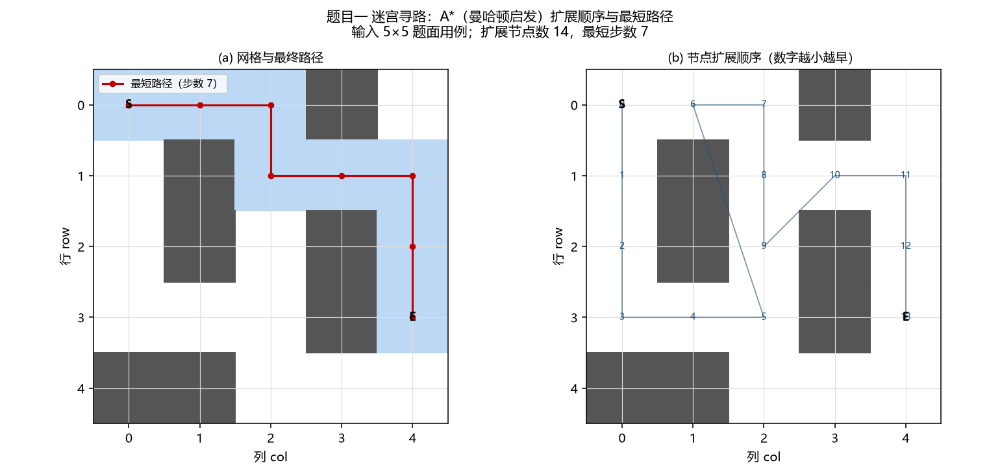
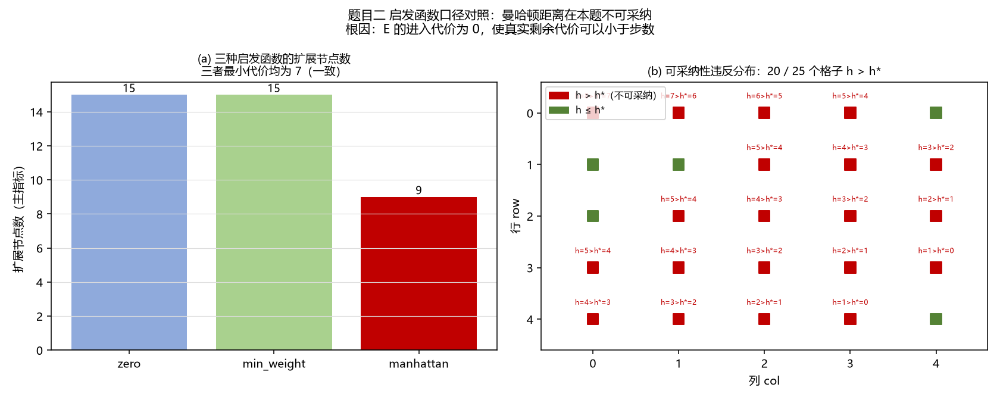
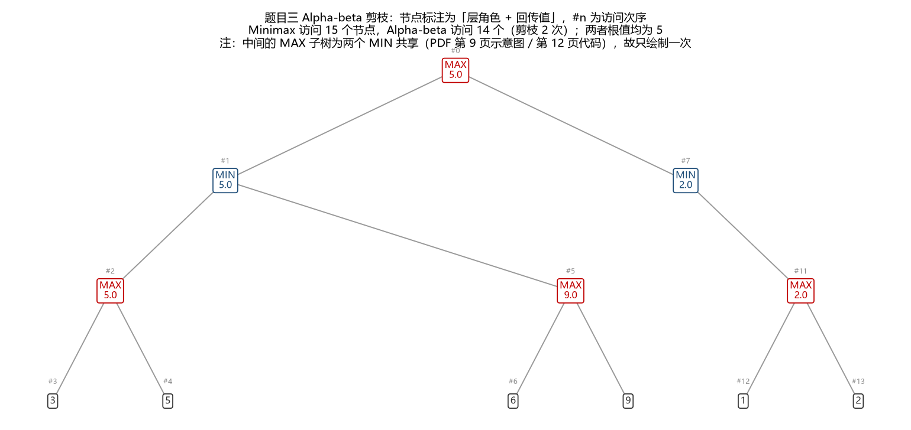
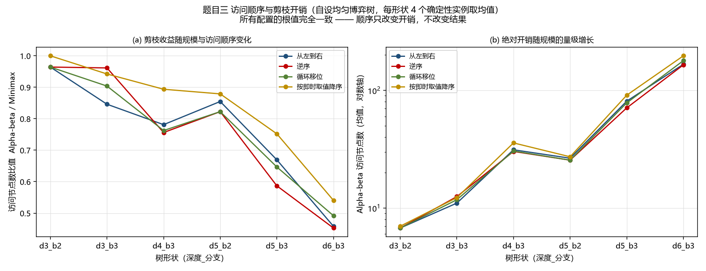
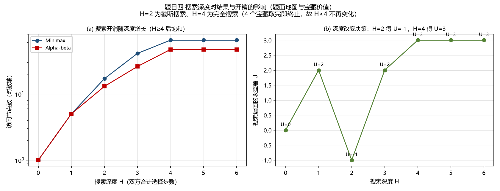

# 实验二 实验报告 · 搜索算法

当代人工智能实验课 · 实验二 ｜ 提交截止 2026-11-12 23:59:59 ｜ 仓库链接：https://github.com/oceancat91/AI-Lab.git

> 报告内每个数字均可在 `lab2-search/results/logs/` 的产物中核对；四道题的 PDF 期望输出已全部复现。

## 1. 算法设计与实验设置

**A\*（题目一、题目二共用同一实现）**
状态为网格坐标 `(row, col)`；`g` 为起点到该格的累计进入代价，`h` 为启发估计，`f = g + h`。
优先队列用二叉堆，以 `(f, h, tie_seq, node)` 入堆：`tie_seq` 保证 f 相同时顺序确定，也避免元素不可比时报错。
启发函数三种：`h ≡ 0`（即 Dijkstra，作基线）、曼哈顿距离（题面提示）、`min_weight × 曼哈顿`（保下界）。
代价模型两处约定均由期望输出验证：起点不计代价；**进入 E 的代价为 0**（题面明文，取 0 得 7、取 1 得 8）。

**Minimax 与 Alpha-Beta（题目三、题目四共用同一引擎）**
状态接口为 `is_terminal / evaluate / current_role / successors`。题目三的 `TreeNode` 与题目四的博弈状态
都适配到这一接口，因而两者只差「是否剪枝」一个变量。
剪枝逻辑：MAX 层维护 `alpha = max(alpha, value)`，MIN 层维护 `beta = min(beta, value)`；
`alpha ≥ beta` 时剩余子节点不再生成。平局取先出现者，故结果与子节点顺序无关。

**题目四状态表示**：`(pos_a, pos_b, remaining, score_a, score_b, to_move)`
—— 双方位置、剩余宝藏、累计收益、当前玩家；`U = score_a − score_b`，`Gain(p, Ti) = Vi − d(p, Ti)`，
`d` 由 A\* 现算、不硬编码。

**实验设置**：主指标为**扩展节点数 / 访问节点数**（确定性、可复算），随机种子 `SEED = 42`。
题面用例规模过小（Q1 可通行格 18 个、Q3 整棵树 15 个节点），故效率类结论一律建立在自设的更大输入上。

## 2. 题目一：迷宫寻路

**最短路径的形成过程**：`f` 最小的节点依次弹出。曼哈顿距离在四方向等代价网格上是精确下界，
故搜索几乎沿最短路径推进，只在并列 `f` 时小幅铺开（下图左：路径；右：扩展次序）。

题面用例实测：A\* 返回步数 **7**，与期望输出**逐坐标相同**；扩展 14 个节点。
最优性用**独立实现**的 BFS 复核（步数一致），路径合法性单独校验（连续、不穿障碍、无重复）。

**h=0 与曼哈顿距离的节点数比较**：题面用例上 h=0 扩展 17 个、曼哈顿 14 个，仅差 3 个，不足以论证效率。
故自设 5×5 / 20×20 / 41×41 三档、每档 6 个确定性迷宫：

| 规模 | 曼哈顿 / h=0 扩展节点数比值（最小 / 最大 / 均值） |
|---|---|
| 5×5 | 0.391 / 0.909 / 0.551 |
| 20×20 | 0.156 / 0.414 / 0.247 |
| 41×41 | 0.114 / 0.322 / 0.204 |

规模越大收益越明显（均值 0.551 → 0.204）：h=0 的扩展数与可通行格数近似成正比，而曼哈顿引导搜索集中在
起终点连线附近。单个用例差异很大（0.114~0.909），故必须给分布；所有配对的最短步数完全一致。

## 3. 题目二：加权地形

**路径代价的累计过程**（S=(0,0) → E=(4,4)，最小代价 **7**，与期望一致）：

| 步 | 0 | 1 | 2 | 3 | 4 | 5 | 6 | 7 | 8 |
|---|---|---|---|---|---|---|---|---|---|
| 进入代价 | — | 1 | 1 | 1 | 1 | 1 | 1 | 1 | **0** |
| 累计 | 0 | 1 | 2 | 3 | 4 | 5 | 6 | 7 | **7** |

**步数是 8、代价是 7**：进入 E 的最后一步免费。若把 E 当普通格（代价 1），最小代价会变成 8 ——
故「E 视为 0」是被期望输出交叉验证的口径。

**启发函数的可采纳性**：可采纳性要求 `h(n) ≤ h*(n)`。用 Dijkstra 逐格现算 `h*` 后实测：
**25 个格子中有 20 个**出现 `h_曼哈顿 > h*`。根因是曼哈顿隐含「每步至少付出 1」，而 E 的代价为 0，
使 `h*` 可小于步数。尽管存在高估，A\* 仍返回最小代价 7（与 Dijkstra 一致）—— 但**「可采纳性被破坏」
与「本用例未出现次优解」是两件事**，本实验未构造次优反例，故不能宣称「本题用曼哈顿总是最优」。

保下界的替代启发函数 `min_weight × 曼哈顿` 在本题**退化为 `h ≡ 0`**（E 的代价 0 即全图最小可通行代价），
实测扩展数与 Dijkstra 相同 —— 说明**「可采纳」与「有信息量」是两件事**。

## 4. 题目三：Alpha-Beta 剪枝

**数值回传与剪枝依据**：题面树共 15 个节点。MAX 层取 max → `5, 9, 2`；MIN 层取 min → `5, 2`；
根 MAX 取 max → **5**，与题面推导逐项吻合。剪枝依据：MIN 层确定 `beta ≤ alpha` 后，剩余子节点不可能改变
上层决策。该树上 Minimax 访问 15 个节点，Alpha-Beta 访问 14 个（剪枝 2 次）。

**不同子节点访问顺序的开销**：题面树四种顺序的访问数都是 14，无法区分，故自设 24 棵均匀博弈树
（深度 3–6 × 分支 2–3，每形状 4 个实例）：剪枝比（Alpha-Beta / Minimax）**0.371 ~ 1.000，均值 0.762**；
四种顺序的根值**全部一致**（顺序只改开销不改结果）；同一棵树内不同顺序的访问数极差最大 **90** 个节点。

## 5. 题目四：竞争环境下的宝藏分配

**距离矩阵（任务 1）**：6×6 最小移动代价矩阵全部由 A\* 现算，并用 Dijkstra 逐条复核一致；矩阵对称、对角为 0。

| 起点＼终点 | A | B | T1 | T2 | T3 | T4 |
|---|---|---|---|---|---|---|
| **A** | 0 | 12 | 10 | 4 | 8 | 8 |
| **B** | 12 | 0 | 8 | 8 | 4 | 10 |
| **T1** | 10 | 8 | 0 | 6 | 6 | 12 |
| **T2** | 4 | 8 | 6 | 0 | 6 | 6 |
| **T3** | 8 | 4 | 6 | 6 | 0 | 6 |
| **T4** | 8 | 10 | 12 | 6 | 6 | 0 |

**H=2 与 H=4 的决策差异（任务 3）**：

| 深度 H | Minimax | Alpha-Beta | 最优首步 | U |
|---|---|---|---|---|
| 2 | 访问 17 | 访问 13（剪枝 2 次） | **T2** | **−1** |
| 4 | 访问 65 | 访问 47（剪枝 12 次） | **T3** | **3** |

两者与题面期望输出**完全一致**。`H` 是**双方合计的选择步数（ply）**：只有按此解释才同时复现两个期望输出
（按「每方 H 次」解释 H=2 会得到 (T3,3)）。4 个宝藏取完即终止，实测 H=5、H=6 与 H=4 结果相同，
故 **H=4 是完全搜索、H=2 是截断搜索**：H=2 时 A 只看到「B 抢一个」就结束，评估偏悲观而选了「损失最小」的 T2；
H=4 看到完整博弈，选 T3 反而取得 +3 —— **深度不足会误导决策**。

**不同访问顺序的剪枝效果**：H=4、Alpha-Beta，三种顺序的 U 与首步完全相同，但访问数为
`asc` 47、`desc` 46、**按即时收益降序 37**。后者让高价值宝藏先被考察，MIN 层更快拿到紧的 beta 上界。

## 6. 自设对照实验与拓展

除上述对照外，另做了下列实验（均含对照数字，**负结果如实保留**）：

| 变量 | 实测结论 |
|---|---|
| 优先队列实现 | `heapq` 与线性扫描的**扩展顺序逐项相同**、节点数相同，差别只在弹出代价 |
| 剪枝开关 | 剪枝**从不改变**博弈值；Alpha-Beta 读取的叶子数不超过 Minimax |
| 加权 A\*（w=1.0~3.0） | **负结果**：w>1 的扩展数与 w=1.0 完全相同（87/87/87/87，w=3.0 为 89）且全部保持最优 |
| 平局打破规则 | 36 个迷宫中 **17 个**的扩展数随规则改变，最大差 **957** 个节点；最短步数始终不变 |
| 置换表缓存 | 大规模博弈（13×13、8 宝藏）命中 215 次、访问减少 **4.1%**；题面 4 宝藏上命中 **0** 次 |

**判断**：唯一有正收益的创新点是**置换表**，其收益来自「不同到达顺序汇聚到同一状态」，取决于状态重复度；
加权 A\* 无效则因题目二以代价 1 为主且 E 免费，曼哈顿已接近精确。

## 7. 图表展示与独立思考：结论与局限

**结论**：① 四题期望输出全部复现（7 / 7 / 5 / (T2,−1) 与 (T3,3)）；② 启发函数收益随规模增长，
但必须给分布（0.114~0.909）；③ 题目二曼哈顿距离**不可采纳**（20/25 格高估），根因是「E 免费」；
④ 剪枝不改变博弈值，收益随规模增长（0.371~1.000）；⑤ H=4 为完全搜索，深度不足会误导决策；
⑥ 访问顺序只改开销不改结果；⑦ 置换表仅在大规模上有收益（2.3%~6.1%）。

**局限与未验证项**：① 测试用例以题面正文四个用例为准（已全部复现）；若另发独立用例采用函数签名或
stdin/stdout 形式，需加适配层。② 题面内题目三存在结构歧义（JSON 输入 8 叶 vs 示意图/推导 6 叶），
三种口径根值**都是 5**，本实现采用 6 叶结构。③ 双向 A\*（19 个可达用例全部更差）与迭代加深的负结果
只在被测量的输入上成立，未做理论证明。④ 未做统计显著性检验：比较均为确定性输入上的实测差值。
