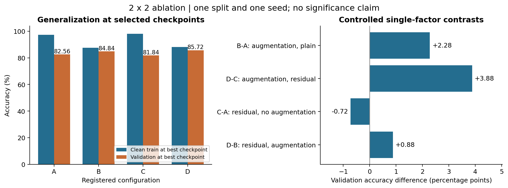
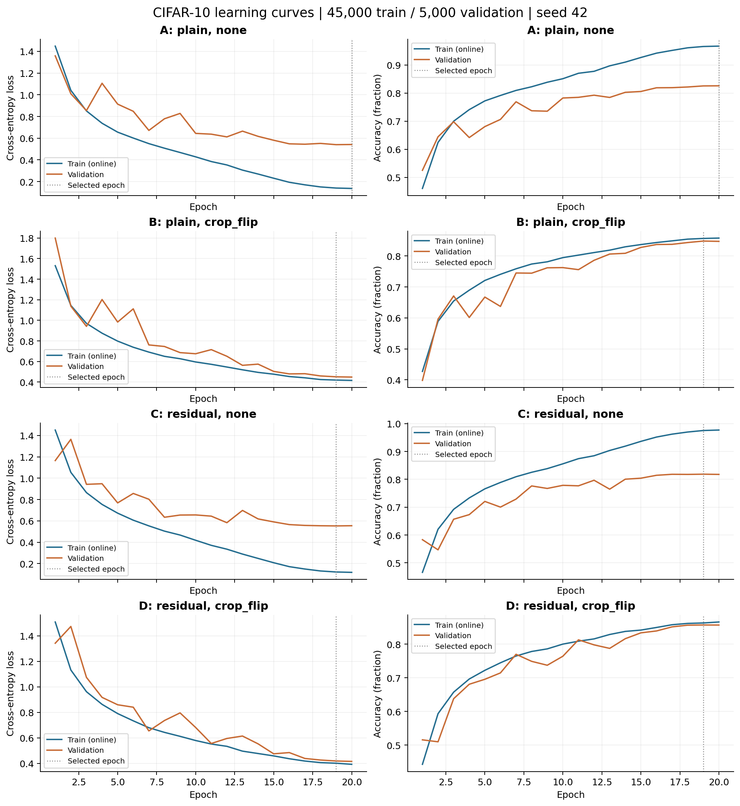
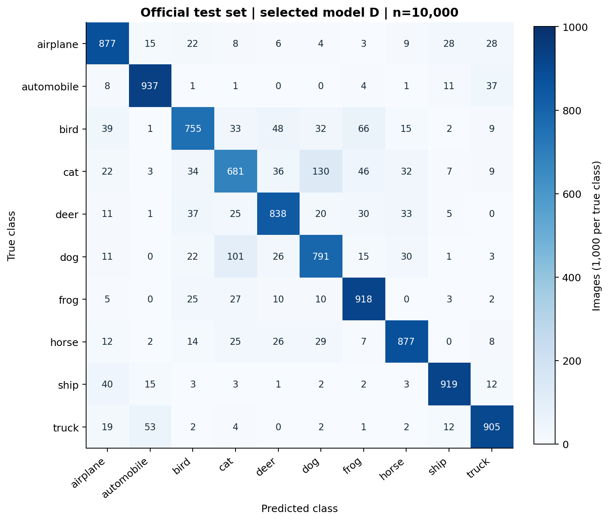
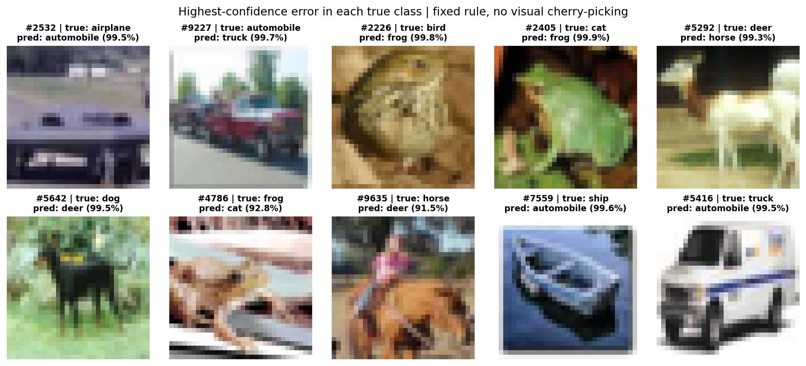
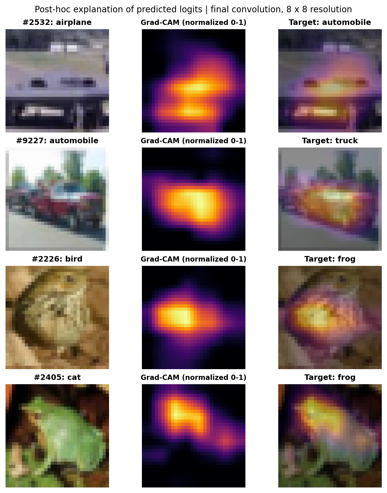

# 当代人工智能作业三：CIFAR-10 图像分类

## 01 / 任务、数据与模型设计

当代人工智能作业三：CIFAR-10 图像分类。实验目标是在可复现的数据隔离流程下，比较小型 CNN 的残差结构与数据增强，并解释最终分类错误。所有性能数字来自本机执行记录。

最终模型为配置 D（residual / crop_flip），验证准确率 85.72%；官方测试集正确 8498/10,000，准确率 84.98%，macro-F1=0.8487。模型由验证结果选出，测试结果未参与选择。

### 数据与防泄漏设计

使用官方 CIFAR-10 Python 版本 [1]。50,000 张训练图像按类别、种子 42 划分为 45,000 张训练和 5,000 张验证，每类分别 4,500/500 张。官方 10,000 张测试图像保持独立，每类 1,000 张。所有输入均为 RGB、32×32。下载包与批次均校验 MD5，并保存 SHA256。

划分后仅用训练子集估计像素通道均值：0.491840, 0.482541, 0.446820；标准差：0.247051, 0.243542, 0.261692。变换为 (x/255 - mean)/std。验证和测试不使用随机增强，不参与统计量拟合。

### 自行实现的 CNN

| 阶段 | 卷积与操作 | 输出形状（不含批次） |
| --- | --- | --- |
| 输入 | RGB 标准化 | 3×32×32 |
| Block 1 | 3×3 Conv: 3→16→16；BN/ReLU；MaxPool | 16×16×16 |
| Block 2 | 3×3 Conv: 16→32→32；BN/ReLU；MaxPool | 32×8×8 |
| Block 3 | 3×3 Conv: 32→64→64；BN/ReLU；MaxPool | 64×4×4 |
| 分类头 | Global Average Pool；Linear 64→10 | 10 logits |

plain 分支每块依次执行 Conv-BN-ReLU-Conv-BN-ReLU-Pool。residual 分支在第二次 BN 后增加 1×1 Conv+BN 的投影支路，然后相加、ReLU、池化；这是针对小图像实现的浅层残差 CNN，不是直接调用标准 ResNet。残差思想参考 [2]，所有权重从头初始化。

plain 有 72,954 个可训练参数；residual 有 75,786 个。BatchNorm 和权重衰减用于所有配置，架构变化包含投影支路及其参数开销，不能解释为“完全等参数”比较。

## 02 / 实验设置与受控对照

四组构成 2×2 因子实验。SGD：初始 lr=0.1，momentum=0.9，weight_decay=0.0005；交叉熵；batch=256；固定 20 轮。前两轮 lr 为 0.05/0.1，此后按余弦衰减至 0.001。无早停、无预训练、无额外数据。

在 AMD Ryzen 5 5600H CPU 上采用 FP32、channels_last、6 个计算线程；线程数仅由合成输入计时选定。数据顺序与增强各用独立随机流，四组共享划分和优化协议。四组训练及最佳检查点训练集评估共用时 45.4 分钟，未计下载及环境安装。

crop_flip：反射填充 4 像素、随机裁剪回 32×32、概率 0.5 水平翻转，仅用于训练。最佳检查点按验证 accuracy 降序、loss 升序、轮次升序选择；最终配置继续按参数量、配置 ID 打破平局。

| 配置 | 架构 / 增强 | 最佳轮 | 干净训练 Acc | 验证 Acc | 分钟 |
| --- | --- | --- | --- | --- | --- |
| A | plain / none | 20 | 97.25% | 82.56% | 11.3 |
| B | plain / crop_flip | 19 | 87.58% | 84.84% | 11.0 |
| C | residual / none | 19 | 98.06% | 81.84% | 11.9 |
| D | residual / crop_flip | 19 | 88.07% | 85.72% | 11.2 |

实测单因素差异：B-A: augmentation, plain：+2.28 个百分点；D-C: augmentation, residual：+3.88 个百分点；C-A: residual, no augmentation：-0.72 个百分点；D-B: residual, augmentation：+0.88 个百分点。

以上是同一划分和种子下的条件性差异。B-A 与 D-C 检验增强在不同架构中的作用；C-A 与 D-B 检验残差在不同增强条件中的作用。D-A 同时改变两个因素，不能单独归因。单次训练的差异不等于统计显著性。

具体而言，残差结构在无增强时的验证差异为 -0.72 个百分点，有增强时为 +0.88 个百分点，不能据此认为残差总能提高准确率。两种条件下的残差效应相差 1.60 个百分点，提示结构收益依赖训练条件，需更多种子验证。

余弦调度在所有配置中一致，属于已实现的训练策略；本次未与恒定学习率另做消融，不能把整体提升单独归功于调度。

## 03 / 训练过程与泛化讨论

图中训练指标在训练模式、逐批参数更新过程中计算；增强组的训练输入经过随机增强，验证指标来自当轮结束后的固定模型。因此两条曲线的数值差不能直接当作严格的泛化差距。

为建立可比口径，表 02 的训练准确率使用最佳检查点、eval 模式、无增强、完整 45,000 张训练图像。最终模型在此口径下训练 Acc=88.07%，验证 Acc=85.72%，差值为 2.35 个百分点。

实测：A/C 在后期仍提高训练准确率，但验证曲线在约 82% 附近趋缓，最佳检查点的干净训练/验证差分别为 14.69/16.22 个百分点；B/D 的对应差为 2.74/2.35 个百分点。增强降低了训练拟合程度，却提高了验证表现，符合其缓解过拟合的解释。早期验证 loss 有明显波动，后期随学习率减小而趋稳；这只是同时发生的现象，未单独验证调度的因果作用。D 在第 19 轮的验证准确率最高，第 20 轮 loss 略低但 accuracy 略低，按预注册的 accuracy 优先规则选择第 19 轮。

## 04 / 测试集结果与混淆矩阵

冻结的配置 D、第 19 轮检查点在测试集正确 8498/10,000，总体准确率 84.98%，交叉熵 0.4420，macro-F1=0.8487。近似 Wilson 95% 区间为 [84.27%, 85.67%]；它只描述有限测试样本的不确定性，不包含重新训练或重新划分的不确定性。

| 真实类别 | 正确 / 样本 | 类别准确率 | Precision | F1 |
| --- | --- | --- | --- | --- |
| airplane | 877/1000 | 87.70% | 0.840 | 0.858 |
| automobile | 937/1000 | 93.70% | 0.912 | 0.925 |
| bird | 755/1000 | 75.50% | 0.825 | 0.789 |
| cat | 681/1000 | 68.10% | 0.750 | 0.714 |
| deer | 838/1000 | 83.80% | 0.846 | 0.842 |
| dog | 791/1000 | 79.10% | 0.775 | 0.783 |
| frog | 918/1000 | 91.80% | 0.841 | 0.878 |
| horse | 877/1000 | 87.70% | 0.875 | 0.876 |
| ship | 919/1000 | 91.90% | 0.930 | 0.925 |
| truck | 905/1000 | 90.50% | 0.893 | 0.899 |

矩阵行是真值、列是预测，每行合计 1,000。每类准确率定义为该类正确数/该类样本数，即该类召回率；总体准确率是全部正确样本/10,000。由于测试类均衡，总体准确率也等于各类准确率的算术平均。

## 05 / 误分类样本分析

按预先约定规则，从每个官方标签类别选择预测置信度最高的错误，同分取最小测试索引。图中的 true 指官方标签，不是另行人工复标的结果。这展示的是高置信错误，不是随机抽样，也不代表各类错误频率。图像按原始 32×32 最近邻放大，保留其低分辨率特征。

最常见的有向混淆（实测）：cat→dog 130 张；dog→cat 101 张；bird→frog 66 张；truck→automobile 53 张；bird→deer 48 张。

矩阵显示 cat→dog 有 130 张，dog→cat 有 101 张，合计 231 张；cat 的类别准确率为 68.10%，是十类中最低。这支持优先分析猫狗混淆，而不是把极端高置信个案当作主要错误分布。两类在 32×32 图像上可能共享毛色、脸部和姿态线索，但未通过逐例复标证明每一个错误都由这些因素造成。

高置信个案与标签疑点：#2532（官方 airplane，预测 automobile）呈现类似汽车前部的外观；#7559（ship→automobile）也呈车辆前部样轮廓。#2226（bird→frog）是褐色、带斑纹的圆形主体；#4786（frog→cat）可见猫脸样的耳部和眼部轮廓。这些例子提示官方标注可能存在疑点，不能直接视为模型忽略了正确物体特征。

对此额外完成了数据一致性审计：用 torchvision.datasets.CIFAR10 独立解码，全部 10,000 张图像、标签及类别名称与自写加载器逐项一致，排除了图像与标签错位。该审计只能确认原文件内容一致，不能证明语义标签正确；未进行人工重标，所有样本仍按官方标签计入 84.98% 的测试准确率。

类别边界与细节缺失：#9227（automobile→truck）的车辆外形与背景较复杂，#5416（truck→automobile）的箱式车轮廓与普通车辆共享特征；#5292（deer→horse）、#5642（dog→deer）、#9635（horse→deer）涉及四足动物轮廓与低分辨率细节。#2405（cat→frog）的绿色主体与常见猫外观差异较大，也需将标签疑点作为一种可能性。上述判断来自目视观察，并非已验证的误分类因果机制。

解释边界：上述视觉线索是针对具体图像的解释假设；没有额外标注、遮挡实验或反事实对照，不能证明模型真正依据了某个物体部位。softmax 置信度也不是经过校准的正确概率。

## 06 / Grad-CAM 与扩展思考

对上一节按类别顺序确定的前 4 个误例，解释模型预测类别的 logit。对最后一个卷积层 features.2.conv2 的 8×8 特征图计算梯度空间均值权重，再取加权和、ReLU，归一化并双线性上采样至 32×32 [3]。不反向更新权重。

目视观察：#2532 的 automobile 热区主要位于图像下半部、中间的车辆前部样结构；#9227 的 truck 热区集中在中央车体附近，背景上方响应较弱。它们与画面中的车辆外观存在空间对应，但不足以证明模型学会了某个具体部件概念。

#2226 的 frog 热区集中于圆形主体中央；#2405 的 frog 热区集中于绿色主体的上部，并向右下延伸。这里只解释预测类别，未把官方标签当作反向传播目标。日志分别保存 official target（target 字段）、prediction 和 explained_class，避免把真实标签与解释目标混淆。

热图展示目标分数对特征的梯度关联，不是对象分割，也不是因果证明。8×8 分辨率本身很粗，上采样不能补充真实空间信息。测试误例和热图只用于事后分析，未反过来修改模型。

后续可在独立实验中比较更长训练预算、多种子、多尺度特征、注意力或校准方法。这些实验需重新注册验证协议，并保留独立测试数据。本次未把这些建议写成已实现的结果。

## 07 / 复现、局限与参考来源

### 执行与结果证据

从代码目录按 README 创建 conda 环境，再运行 run_pipeline.py 的 environment、prepare、verify、train、select、test、analyze 阶段。每阶段经过 check_rigor.py 门禁；训练脚本会输出并读取仓库根及实验的规范文件。完整命令见 README.md。

results/logs/split.json 保存全部 45k/5k 索引及训练统计量；run_A-D.json 保存源码/划分/检查点指纹、参数和最佳轮次；results/tables/history_A-D.csv 保存 80 轮曲线；selection.json 是测试前冻结的选模记录；test_predictions.csv 保存按官方顺序的 10,000 行预测及概率，可独立复算矩阵与准确率。

原始 CIFAR-10 和检查点不上传仓库；下载校验和完整训练命令可重新生成。environment.yml 定义 conda 依赖，environment-lock.txt 固定本次 Windows 构建。报告的关键数值由已落盘的 JSON/CSV 自动填入。

### 复核范围与局限

正式实验覆盖 4 个配置、每组 20 轮、完整 45,000 张训练子集。独立环境复核记录见 reproduction.json，区分依赖安装、划分/统计量复算、逐样本预测指标复算和短程训练重放；短程重放不代表在第二环境重训了完整 80 轮。

本实验只使用一个种子和一次划分，验证集被用于选择架构和轮次，验证结果存在选择偏差。测试评估的是选出的单个模型；其他配置的测试成绩没有计算。小型网络、CPU 预算与 20 轮训练限制了可达到的性能，不能声称最优架构或充分收敛。

课程评分包括实现、性能、报告和创新，题面没有给出准确率到分数的映射。本报告不预测得分。GitHub 是本次交付位置；课程 PDF 指定的坚果云提交渠道仍应单独处理。

### 参考来源

[1] Krizhevsky, A. (2009). Learning Multiple Layers of Features from Tiny Images. 数据集说明与校验值：https://www.cs.toronto.edu/~kriz/cifar.html

[2] He, K., Zhang, X., Ren, S., & Sun, J. (2015). Deep Residual Learning for Image Recognition. https://arxiv.org/abs/1512.03385

[3] Selvaraju, R. R., et al. (2016/2019). Grad-CAM: Visual Explanations from Deep Networks via Gradient-based Localization. https://arxiv.org/abs/1610.02391

[4] PyTorch 官方教程：Training a Classifier；实际执行版本 PyTorch 2.5.1 / torchvision 0.20.1。https://docs.pytorch.org/tutorials/beginner/blitz/cifar10_tutorial.html

[5] 课程材料：《当代人工智能作业三——图像分类》，2026-11-05，6 页；任务第 5 页、评分第 6 页。
